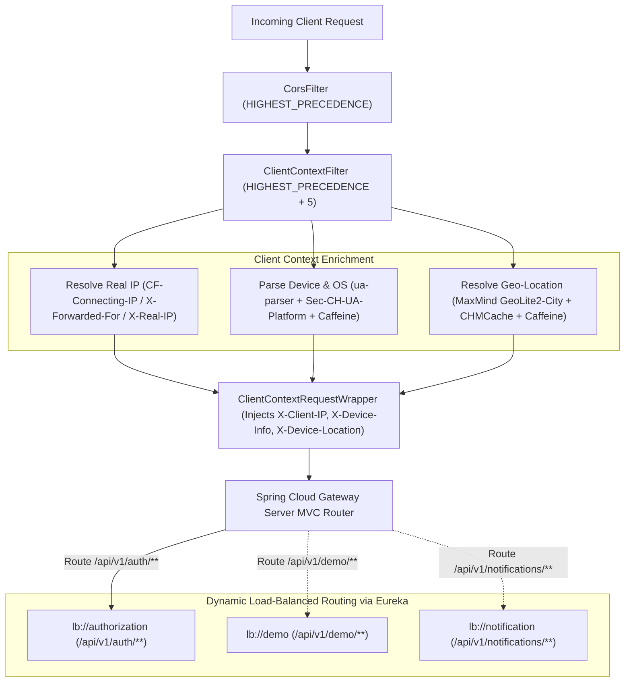

# Vaultix API Gateway

[](https://openjdk.org/)
[](https://spring.io/projects/spring-boot)
[](https://spring.io/projects/spring-cloud)
[](https://openjdk.org/jeps/444)
[](https://www.maxmind.com/)
[](https://opensource.org/licenses/Apache-2.0)

The high-performance, single entry-point reverse proxy and API Gateway for the **Vaultix** distributed microservices platform, built on **Spring Cloud Gateway Server MVC** and **Java 27 Virtual Threads** (Project Loom).

---

## Service Overview

| Attribute | Specification |
| :--- | :--- |
| **Port** | `8085` (Public edge gateway port for Web, Mobile, and API clients) |
| **Framework** | Spring Boot `4.1.2` / Spring Cloud `2025.1.4` (`spring-cloud-starter-gateway-server-webmvc`) |
| **Runtime** | Java 27 (OpenJDK / Amazon Corretto 27) with Virtual Threads enabled |
| **Discovery Client** | Eureka Client (`http://localhost:8761/eureka/`) |
| **Architecture** | Servlet-based Spring MVC Gateway powered by lightweight Virtual Threads |
| **Enrichment Engine** | MaxMind GeoIP2 City database + `ua-parser` device resolution + 24-hour Caffeine caches |
| **Security & CORS** | Strict origin validation, credentials support, and exposed header propagation (`X-Sudo-Required`) |

---

## Architectural Request Pipeline

Every incoming request flows through an ordered filter pipeline before dynamic load-balanced dispatch:



---

## Directory Structure

```text
gateway/
├── pom.xml                                    /* Spring Boot 4.1.2, Spring Cloud Gateway MVC */
├── README.md                                  /* Service runbook and overview */
├── .env.example                               /* Template environment variables */
├── docs/
│   └── ARCHITECTURE.md                        /* Comprehensive routing and filter manual */
└── src/main/
    ├── java/com/vaultix/gateway/
    │   ├── GatewayApplication.java            /* Main Spring Boot entry point */
    │   ├── config/
    │   │   ├── CorsConfig.java                /* Global UrlBasedCorsConfigurationSource */
    │   │   └── properties/
    │   │       ├── CorsProperties.java        /* Immutable record binding vaultix.cors */
    │   │       └── GeoIpProperties.java       /* Immutable record binding vaultix.geoip */
    │   ├── filter/
    │   │   ├── ClientContextFilter.java       /* Request interception and header resolution */
    │   │   └── ClientContextRequestWrapper.java /* HttpServletRequestWrapper header injection */
    │   └── service/
    │       ├── DeviceParserService.java       /* User-Agent & Client Hints parsing + Caffeine */
    │       └── GeoIpService.java              /* MaxMind GeoLite2-City reader + Caffeine */
    └── resources/
        └── application.yaml                   /* Routes, CORS, GeoIP, and Virtual Thread settings */
```

---

## Configuration Reference (`application.yaml`)

| Property / Environment Variable | Default Value | Description |
| :--- | :--- | :--- |
| `SERVER_PORT` | `8085` | HTTP listen port for the Gateway |
| `server.compression.enabled` | `true` | Gzip compression for responses > 1024 bytes |
| `spring.threads.virtual.enabled` | `true` | Enables Project Loom Virtual Threads on Java 27 |
| `spring.jackson.property-naming-strategy` | `SNAKE_CASE` | Global JSON naming convention across all payloads |
| `EUREKA_CLIENT_SERVICE_URL_DEFAULTZONE` | `http://localhost:8761/eureka/` | Discovery server service registry URL |
| `VAULTIX_CORS_ALLOWED_ORIGINS` | `http://localhost:3000,http://localhost:5173` | Allowed frontend origins (supports dev tunnels) |
| `VAULTIX_CORS_ALLOWED_METHODS` | `GET,POST,PUT,DELETE,PATCH,OPTIONS` | Permitted HTTP verbs |
| `VAULTIX_CORS_ALLOWED_HEADERS` | `*` | Permitted request headers |
| `VAULTIX_CORS_ALLOW_CREDENTIALS` | `true` | Allows cookies and Authorization headers |
| `VAULTIX_CORS_MAX_AGE` | `3600` | Preflight cache lifetime in seconds |
| `VAULTIX_CORS_EXPOSED_HEADERS` | `X-Sudo-Required` | Exposes step-up sudo response header to browser clients |
| `VAULTIX_GEOIP_DATABASE_PATH` | `../infra/geoip/GeoLite2-City.mmdb` | Path to MaxMind GeoLite2-City database file |

---

## Quickstart & Local Execution

### 1. Prerequisites
- **Java 27** (OpenJDK / Amazon Corretto 27)
- **Eureka Server** running on `http://localhost:8761`
- **GeoLite2-City.mmdb** placed at `infra/geoip/GeoLite2-City.mmdb` (optional; falls back gracefully to `"Local"` or `"Unknown"` if missing)

### 2. Build
```powershell
.\mvnw.cmd clean package
```

### 3. Run
```powershell
.\mvnw.cmd spring-boot:run
```

Once running, all client requests can target `http://localhost:8085` for automatic enrichment and dynamic routing.

---

## In-Depth Documentation

For full details on filter chaining, GeoIP resolution, Client Hints parsing, and Spring Cloud Gateway Server MVC architecture, see:

👉 [**Architecture & Routing Pipeline Deep-Dive (docs/ARCHITECTURE.md)**](docs/ARCHITECTURE.md)
