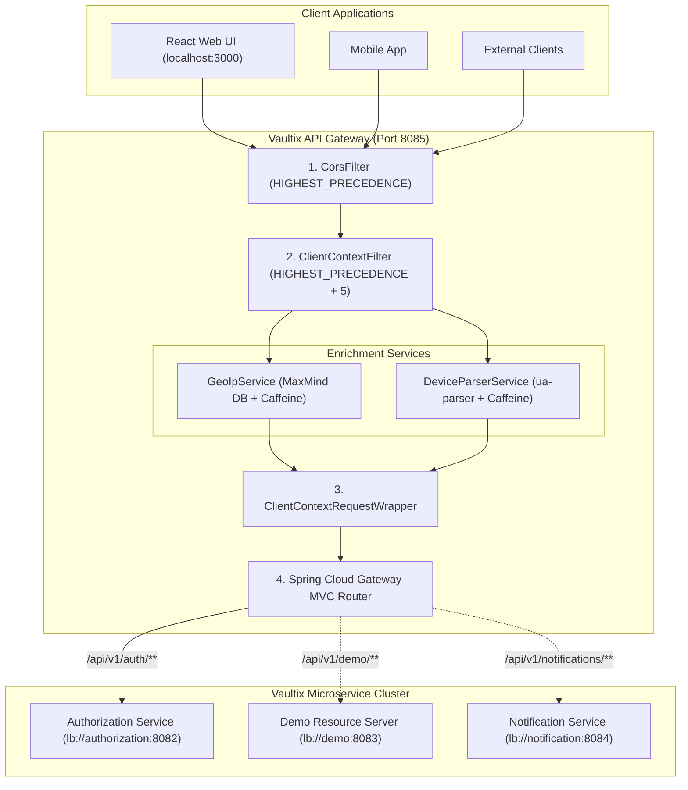
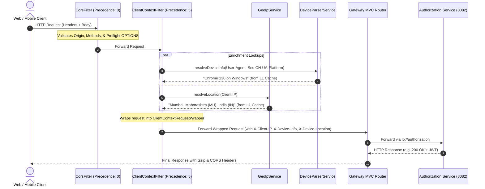

# Vaultix API Gateway - Architecture & Routing Pipeline

Comprehensive architectural specification and technical manual for reverse proxy routing, request decoration, client context extraction, and edge security in the **Vaultix API Gateway**.

---

## Table of Contents
1. [Architecture Overview & Technology Selection](#1-architecture-overview--technology-selection)
2. [Spring Cloud Gateway Server MVC & Virtual Threads](#2-spring-cloud-gateway-server-mvc--virtual-threads)
3. [Ordered Filter Execution Pipeline](#3-ordered-filter-execution-pipeline)
4. [Client Context Enrichment Engine](#4-client-context-enrichment-engine)
   - [Real Client IP Resolution](#real-client-ip-resolution)
   - [Device & OS Resolution (`DeviceParserService`)](#device--os-resolution-deviceparserservice)
   - [Geolocation Resolution (`GeoIpService`)](#geolocation-resolution-geolipservice)
   - [Request Wrapping Mechanics (`ClientContextRequestWrapper`)](#request-wrapping-mechanics-clientcontextrequestwrapper)
5. [CORS Security & Header Propagation](#5-cors-security--header-propagation)
6. [Dynamic Routing via Eureka Service Discovery](#6-dynamic-routing-via-eureka-service-discovery)
7. [Response Compression & Performance Optimizations](#7-response-compression--performance-optimizations)
8. [Configuration & Deployment Matrix](#8-configuration--deployment-matrix)

---

## 1. Architecture Overview & Technology Selection

The **Vaultix API Gateway** is the single entry point for all incoming HTTP traffic from browser clients, mobile applications, and external integrations. It terminates CORS preflight requests, enriches incoming requests with geographic and client device metadata, and dynamically forwards traffic to downstream microservices using Eureka service discovery.



---

## 2. Spring Cloud Gateway Server MVC & Virtual Threads

Unlike legacy Spring Cloud Gateway (built on Spring WebFlux and Project Reactor), the Vaultix API Gateway utilizes **Spring Cloud Gateway Server MVC** (`spring-cloud-starter-gateway-server-webmvc`):

### Why Gateway Server MVC + Virtual Threads?
* **Standard Servlet API**: Retains the simplicity, stability, and tooling of the traditional Servlet model (`HttpServletRequest`, standard filters, Tomcat) without reactive complexity.
* **Java 27 Virtual Threads (Project Loom)**: By enabling `spring.threads.virtual.enabled: true`, every incoming HTTP request is assigned a lightweight virtual thread. Blocking operations (such as downstream proxy calls and MaxMind file lookups) yield execution automatically without consuming operating system threads.
* **Deterministic ThreadLocals**: Seamlessly interoperates with `SecurityContextHolder`, MDC logging, and traditional request-scoped attributes without reactor context propagation hurdles.
* **High Throughput & Low Memory**: Capable of handling tens of thousands of concurrent connections with minimal memory footprint (~few KB per virtual thread).

---

## 3. Ordered Filter Execution Pipeline

Every request entering the Gateway executes through a strictly ordered chain:



### Order Constants:
1. **`CorsFilter` (`Ordered.HIGHEST_PRECEDENCE = Integer.MIN_VALUE`)**: Handles CORS headers and terminates `OPTIONS` preflight requests immediately before any business logic or enrichment executes.
2. **`ClientContextFilter` (`Ordered.HIGHEST_PRECEDENCE + 5`)**: Resolves IP, device, and location, decorating the request with downstream headers.
3. **Gateway Routing Engine**: Evaluates path predicates and forwards to the load-balanced target.

---

## 4. Client Context Enrichment Engine

### Real Client IP Resolution
The Gateway normalizes the client IP across multi-tier proxy architectures using the following precedence rules:
```java
private String resolveRealClientIp(HttpServletRequest request) {
    /* 1. Cloudflare edge header */
    String cfConnectingIp = request.getHeader("CF-Connecting-IP");
    if (cfConnectingIp != null && !cfConnectingIp.isBlank()) {
        return cfConnectingIp.strip();
    }

    /* 2. Standard proxy chain header: take the leftmost (original client) IP */
    String xForwardedFor = request.getHeader("X-Forwarded-For");
    if (xForwardedFor != null && !xForwardedFor.isBlank()) {
        int commaIndex = xForwardedFor.indexOf(',');
        return (commaIndex != -1) ? xForwardedFor.substring(0, commaIndex).strip() : xForwardedFor.strip();
    }

    /* 3. Nginx / AWS ALB real IP header */
    String xRealIp = request.getHeader("X-Real-IP");
    if (xRealIp != null && !xRealIp.isBlank()) {
        return xRealIp.strip();
    }

    /* 4. Direct socket address fallback */
    return request.getRemoteAddr();
}
```

### Device & OS Resolution (`DeviceParserService`)
* **Core Engine**: Built on `ua-parser` (`com.github.ua-parser:uap-java:1.6.1`).
* **Client Hints Integration**: Inspects the modern Chromium header `Sec-CH-UA-Platform` (e.g. `"Windows"`, `"Android"`, `"macOS"`), overriding ambiguous user agent strings.
* **Concise Formatting**: Produces human-readable descriptions such as `"Chrome 130 on Windows"`, `"Safari 18 on iOS"`, or `"Firefox 132 on Linux"`.
* **Caffeine L1 Cache**: Caches parsed results keyed by `userAgent + "|" + secChUaPlatform` for **24 hours** (maximum 10,000 entries), achieving sub-millisecond lookup latency.

### Geolocation Resolution (`GeoIpService`)
* **MaxMind Integration**: Leverages MaxMind GeoIP2 Java API (`com.maxmind.geoip2:geoip2:5.2.0`) reading `GeoLite2-City.mmdb`.
* **High-Concurrency Memory Caching**: Uses MaxMind's internal `CHMCache` (ConcurrentHashMap Cache) combined with a Caffeine L1 cache (10,000 entries, 24-hour TTL).
* **Dual-Path Auto-Discovery**: Checks the primary path (`../Vaultix-infra/geoip/GeoLite2-City.mmdb`) and falls back automatically if run from a subfolder.
* **Comprehensive Location String**:
  $$\text{City, Postal, State (Code), Country (Code) (Lat, Lon, Accuracy, Timezone)}$$
  * Example: `"Mumbai, 400001, Maharashtra (MH), India (IN) (Lat: 19.0760, Lon: 72.8777, Accuracy: 50km, Timezone: Asia/Kolkata)"`
  * Private / Loopback IPs (`127.0.0.1`, `10.0.0.0/8`, `192.168.0.0/16`, `::1`): Evaluated in constant time to `"Local"`.
  * Missing DB or Unresolvable: Defaults cleanly to `"Unknown"` without throwing exceptions.

### Request Wrapping Mechanics (`ClientContextRequestWrapper`)
Extends `HttpServletRequestWrapper` to inject synthetic headers into the downstream servlet pipeline:
* `X-Client-IP`: Resolved public client IP address.
* `X-Device-Info`: Formatted browser and operating system summary.
* `X-Device-Location`: Resolved geographic location.

Overrides `getHeader(String)`, `getHeaders(String)`, and `getHeaderNames()` so downstream proxies and filters observe the enriched headers transparently.

---

## 5. CORS Security & Header Propagation

CORS is managed globally via `CorsConfig` using `UrlBasedCorsConfigurationSource`:

```yaml
vaultix:
  cors:
    allowed-origins: ${VAULTIX_CORS_ALLOWED_ORIGINS:http://localhost:3000,http://localhost:5173,https://zj153pc4-3000.inc1.devtunnels.ms}
    allowed-methods: GET,POST,PUT,DELETE,PATCH,OPTIONS
    allowed-headers: "*"
    allow-credentials: true
    max-age: 3600
    exposed-headers: X-Sudo-Required
```

### Critical Security Capabilities:
1. **Credentials Support**: `allow-credentials: true` enables browser clients to send and receive HTTP-only session cookies and Authorization headers.
2. **Exposed Headers**: Exposing `X-Sudo-Required` allows frontend clients (React/Vite) to detect step-up authentication prompts issued by `@RequireSudo` endpoints and trigger modal dialogs.
3. **Preflight Caching**: `max-age: 3600` caches browser `OPTIONS` responses for 1 hour, reducing unnecessary edge network round-trips.

---

## 6. Dynamic Routing via Eureka Service Discovery

Declarative routes are defined in `application.yaml`:

```yaml
spring:
  cloud:
    gateway:
      server:
        webmvc:
          routes:
            - id: authorization-service
              uri: lb://authorization
              predicates:
                - Path=/api/v1/auth/**
```

### Routing Characteristics:
* **`lb://authorization`**: Directs the gateway to consult the Eureka registry table and dynamically resolve healthy `AUTHORIZATION` instances using Spring Cloud LoadBalancer.
* **Transparent Path Forwarding**: Matches `/api/v1/auth/**` and passes the full path along to the destination microservice.
* **Zero Downtime Deploys**: When a microservice instance restarts or scales up, the Gateway updates its routing table automatically via Eureka heartbeats without restarting the gateway.

---

## 7. Response Compression & Performance Optimizations

### Gzip Compression
Configured in `application.yaml`:
```yaml
server:
  compression:
    enabled: true
    mime-types:
      - application/json
      - text/plain
      - application/xml
    min-response-size: 1024
```
Payloads larger than 1 KB are automatically compressed with Gzip, cutting JSON network transfer sizes by up to 70-80% for large lists and user session tables.

---

## 8. Configuration & Deployment Matrix

| Environment Variable | Default Value | Description |
| :--- | :--- | :--- |
| `SERVER_PORT` | `8085` | Listen port for the Gateway |
| `EUREKA_CLIENT_SERVICE_URL_DEFAULTZONE` | `http://localhost:8761/eureka/` | Discovery service URL |
| `VAULTIX_CORS_ALLOWED_ORIGINS` | `http://localhost:3000,http://localhost:5173` | Permitted client origins |
| `VAULTIX_CORS_ALLOWED_METHODS` | `GET,POST,PUT,DELETE,PATCH,OPTIONS` | Permitted HTTP verbs |
| `VAULTIX_CORS_ALLOWED_HEADERS` | `*` | Permitted request headers |
| `VAULTIX_CORS_ALLOW_CREDENTIALS` | `true` | Allows credentials |
| `VAULTIX_CORS_MAX_AGE` | `3600` | Preflight cache lifetime |
| `VAULTIX_CORS_EXPOSED_HEADERS` | `X-Sudo-Required` | Exposed response headers |
| `VAULTIX_GEOIP_DATABASE_PATH` | `../Vaultix-infra/geoip/GeoLite2-City.mmdb` | Location of GeoLite2-City database |
